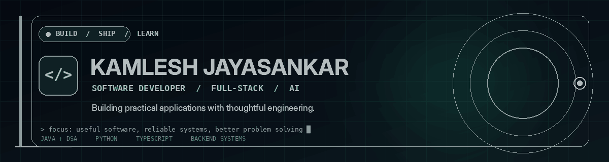

<!--
  Kamlesh Jayasankar — GitHub Profile README
  In your public profile repository, keep this file named README.md and upload
  developer-banner.gif into the same repository root.
-->

  
    
  
    
  
  
  

---

## 👨‍💻 About Me

I'm a **B.Tech Computer Science and Business Systems student** interested in building useful software, designing reliable backend workflows, and integrating AI into practical applications.

- 🔭 **Building:** full-stack products and AI-assisted workflows.
- 🧠 **Practising:** Java, data structures, algorithms, and problem-solving patterns.
- 🏗️ **Interested in:** backend engineering, APIs, AI applications, testing, and software architecture.
- ✅ **Engineering mindset:** clear responsibilities, thoughtful edge-case handling, automated tests, and documentation.
- 🎯 **Goal:** grow into a software developer by building, testing, and improving real projects.

## 🚀 Featured Projects

<table>
  <tr>
    <td width="50%" valign="top">
      <h3><a href="https://github.com/KamleshJayasankar/campusmind">01 · CampusMind</a></h3>
      
<strong>AI document assistant with cited answers</strong>

      
Answers student questions from college documents, cites supporting sources, and abstains when the provided documents do not contain a reliable answer.

      
<strong>Engineering highlights</strong>

      <ul>
        <li>Semantic retrieval with PostgreSQL and pgvector</li>
        <li>Role-based document access and background ingestion</li>
        <li>Redis caching, rate limiting, automated tests, and CI</li>
      </ul>
      
Next.js · React · TypeScript · Express · PostgreSQL · Redis · Gemini

      
 

    </td>
    <td width="50%" valign="top">
      <h3><a href="https://github.com/KamleshJayasankar/cereviora">02 · CEREVIORA</a></h3>
      
<strong>Human-guided task planning and automation</strong>

      
Turns requests into structured plans with explicit approval gates, allowlisted execution, independent verification, and an audit history.

      
<strong>Engineering highlights</strong>

      <ul>
        <li>Finite state machine and policy validation</li>
        <li>Approval-controlled execution and database verification</li>
        <li>Interactive 3D workflow interface</li>
      </ul>
      
Python · FastAPI · SQLite · React · TypeScript · React Three Fiber

      
 

    </td>
  </tr>
  <tr>
    <td width="50%" valign="top">
      <h3><a href="https://github.com/KamleshJayasankar/campuswatch">03 · CampusWatch</a></h3>
      
<strong>Real-time college occupancy monitoring</strong>

      
A computer-vision-based system concept for occupancy tracking, live dashboard updates, analytics, and threshold alerts.

      
<strong>Engineering focus</strong>

      <ul>
        <li>YOLOv8-based people detection and line-crossing logic</li>
        <li>WebSocket updates, APIs, and analytics dashboard</li>
        <li>Role-based access and alerts</li>
      </ul>
      
React · Node.js · Express · MongoDB · Python · YOLOv8

    </td>
    <td width="50%" valign="top">
      <h3><a href="https://github.com/KamleshJayasankar/AI-Food-Freshness-Monitoring-System">04 · AI Food Freshness</a></h3>
      
<strong>Food quality prediction and inventory workflows</strong>

      
A full-stack platform for image-based freshness classification, shelf-life guidance, inventory tracking, and report generation.

      
<strong>Engineering focus</strong>

      <ul>
        <li>TensorFlow image-classification integration</li>
        <li>API and database-backed inventory workflows</li>
        <li>Analytics, notifications, and exports</li>
      </ul>
      
Python · FastAPI · TensorFlow · React · PostgreSQL

    </td>
  </tr>
</table>

## 🧰 Technologies

  <h4>Languages</h4>
  
  <h4>Frontend</h4>
  
  <h4>Backend, Data & Tools</h4>
  

## 🧩 Problem Solving

I practise DSA in Java to improve algorithmic thinking, recognize common patterns, and understand time and space complexity.

- 📘 [DSA Preparation 2026](https://github.com/KamleshJayasankar/DSA-Preparation-2026) — structured learning notes, Java implementations, and progress tracking.
- 💡 [LeetCode solutions](https://github.com/KamleshJayasankar/LeetCode) — a collection of coding-problem solutions.

## 📊 GitHub Activity

  
  

> Language statistics reflect repository contents and are not a measure of overall skill or proficiency.

## 🤝 Let's Connect

I'm interested in learning from other developers, collaborating on practical software projects, and improving through feedback.

  <a href="https://www.linkedin.com/in/kamlesh-jayasankar">LinkedIn</a> ·
  <a href="https://leetcode.com/u/Kamleshjayasankar/">LeetCode</a> ·
  <a href="mailto:kamleshjayasankar@gmail.com">Email</a>
    
  Building thoughtfully. Testing carefully. Improving continuously.

